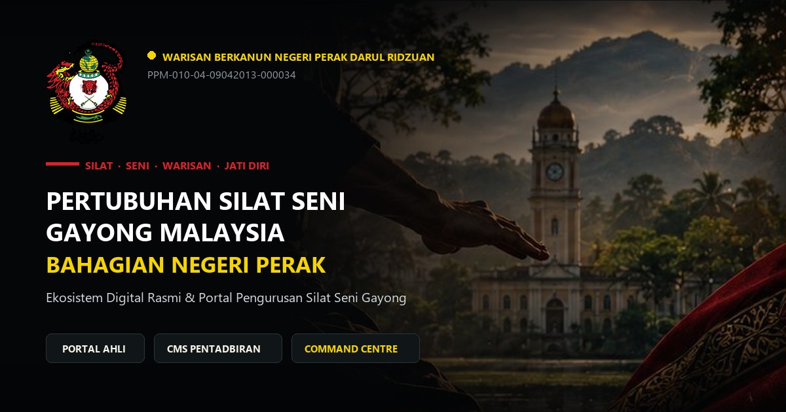

<div align="center">
  

  <h1>GayongX — PSSGM Perak Digital Ecosystem</h1>
  <p><strong>Connected digital ecosystem, cultural heritage portal & AI assistant for Silat Seni Gayong Perak.</strong></p>

  <p>
    <a href="https://gayongx.syahmiaof.my"></a>
    <a href="https://github.com/syahmiaof/gayongx"></a>
    <a href="LICENSE"></a>
    <a href="https://syahmiaof.my"></a>
  </p>

  <p>
    
    
    
    
    
    
    
  </p>
</div>

---

## 📌 Direction & Vision

- **Functionality**: Statewide digital federation platform for Pertubuhan Silat Seni Gayong Malaysia (PSSGM) Negeri Perak connecting public heritage portals, multi-role gelanggang management, and the Tuah Bot AI syllabus mentor.
- **Aesthetic Value**: Premium editorial martial arts presentation crafted with fluid GSAP choreographies, bespoke typography, and responsive multi-tier navigational architecture.
- **Business Value**: Unifies disparate training dojos into a single digital administration hub, digitizing curriculum progress, coach accreditations, and athlete records across the state of Perak.

> **Ecosystem Status**: Active deployment. The public portal, interactive UI, and Tuah AI assistant are fully operational; wider enterprise modules (gelanggang fleet operations, attendance, and certified syllabus exams) follow a staged roadmap.

The platform architecture bridges centuries-old martial arts heritage with cutting-edge web engineering:
1. **Public Identity & Heritage**: Introducing Silat Seni Gayong to the global audience with high-fidelity visuals, historical archives, and custom editorial design.
2. **Tuah Bot AI Assistant**: Digital syllabus guide powered by Google's modern `@google/genai` SDK, offering instant answers on techniques, philosophy, and rank belt progressions.
3. **Gelanggang & Operational Management**: Centralized member rosters, training schedules, and digital grading tracking.
4. **Inter-connected Platform Architecture**: Direct synergy with sister repositories:
   - **[GayongX Athlete Analytics](https://github.com/syahmiaof/gayongx-athlete-analytics)**: Real-time biometric and performance metrics for sparring athletes.
   - **[GayongX Warisan](https://github.com/syahmiaof/gayongx-warisan)**: Interactive 2D heritage combat game built with Phaser 3 and TypeScript.

---

## 🏛️ Ecosystem Architecture

```text
┌──────────────────────────────────────────────────────────────────┐
│                   GayongX Unified Client                         │
│       React 19 + TypeScript + Vite 8 + Tailwind CSS v4           │
└───────────────────────────────┬──────────────────────────────────┘
                                │
        ┌───────────────────────┼────────────────────────┐
        ▼                       ▼                        ▼
┌──────────────────┐  ┌──────────────────┐     ┌──────────────────┐
│ GSAP & Motion UI │  │ Tuah Bot AI Core │     │ Multi-Role Portal│
│ Smooth Animations│  │ (@google/genai)  │     │ - Public Member  │
│ Responsive Flow  │  │ Syllabus Engine  │     │ - Jurulatih      │
└──────────────────┘  └──────────────────┘     │ - Administrator  │
                                               └──────────────────┘
```

---

## 🗺️ Module Roadmap

| Module | Purpose & Scope | Implementation Status |
|---|---|---|
| **Public Portal** | Association overview, heritage history, rank belt matrix, and public enquiries. | ✅ Implemented & Deployed |
| **Tuah Bot AI** | Generative conversational assistant for syllabus queries and training etiquette. | ✅ Implemented (`@google/genai`) |
| **Role Picker & Demo** | Interactive live role-switcher (Public, Pelatih, Jurulatih, Pentadbir). | ✅ Implemented |
| **Gelanggang Operations** | Training centre directory, class schedules, and attendance check-in. | 🔄 In Active Development |
| **Grading & Certification** | Belt grading rubrics, examination records, and verification ledgers. | 📋 Planned Roadmap |
| **Athlete Analytics** | Combat performance, reaction speed, and biometric data tracking. | 🔗 Connected Sub-prototype |
| **GayongX Warisan** | 2D martial arts heritage game with syllabus move execution. | 🔗 Connected Sub-prototype |

---

## 🛠️ Technology Stack

| Layer | Technologies |
|---|---|
| **Frontend Framework** | React 19, TypeScript 5.9, Vite 8 |
| **Styling & Design** | Tailwind CSS v4 (`@tailwindcss/vite`), Lucide React |
| **Motion & Micro-interactions** | GSAP 3.15, `@gsap/react`, Motion 12 |
| **AI Integration** | Google GenAI SDK (`@google/genai` 2.4.0) |
| **Charts & Visuals** | Recharts, SVG Canvas |
| **Service & Deployment** | Express, Node.js, Vercel Edge Hosting, GitHub Actions |

---

## 🛡️ Continuous Integration & Quality Checks

Platform stability is maintained through automated continuous integration workflows:
- **Type Checking**: Strict TypeScript validation ensuring typed component contracts.
- **Production Bundling**: Optimized assets built and tree-shaken with Vite.
- **Continuous Integration**: GitHub Actions workflow (`.github/workflows/ci.yml`) validates codebase health on every push to `main`.

---

## 📄 License

Copyright (c) 2026 Muhammad Syahmi ([syahmiaof](https://syahmiaof.my)). All rights reserved.  
Proprietary source code created solely for demonstration and portfolio showcase purposes.
